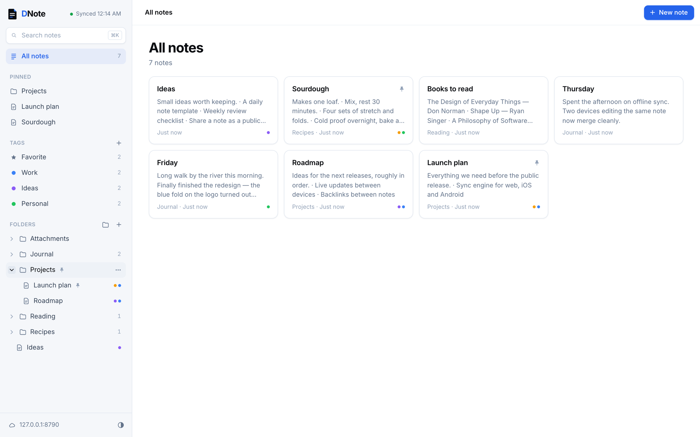
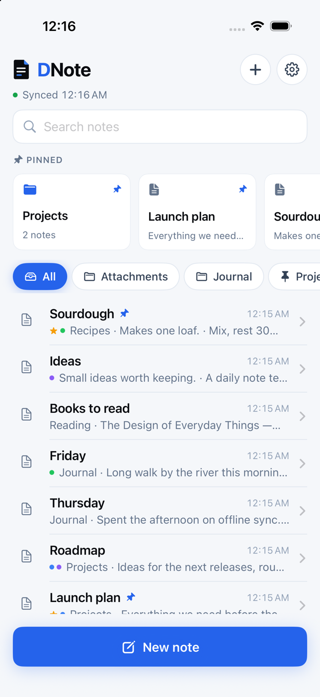
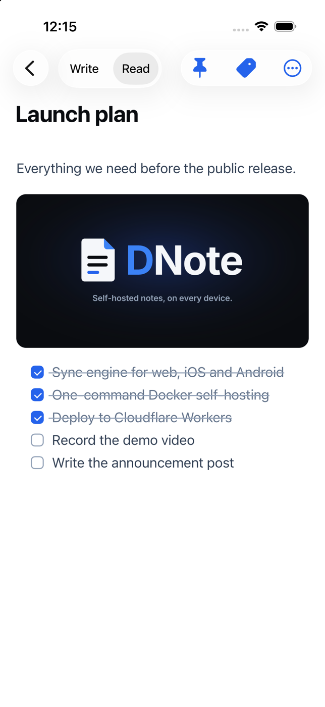
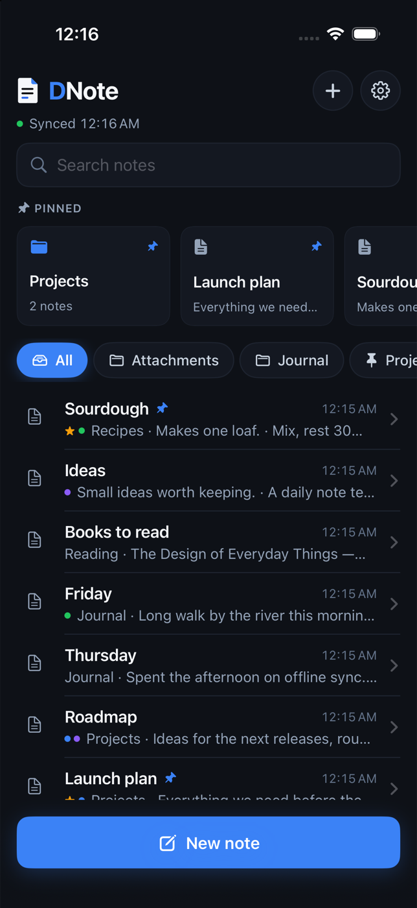
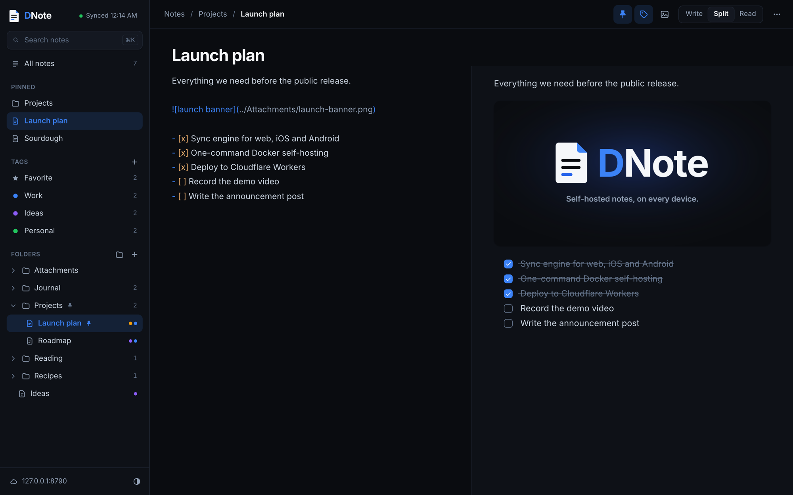

<p align="center">
  <picture>
    <source media="(prefers-color-scheme: dark)" srcset="brand/svg/lockup-horizontal-dark.svg">
    
  </picture>
</p>

<p align="center"><b>Self-hosted notes, on every device.</b></p>

<p align="center">
  Markdown notes in real folders. Beautiful apps for the web, iPhone and Android.<br>
  Sync through a server you own: one Docker container, or free on Cloudflare.
</p>

<p align="center">
  <a href="#get-started">Get started</a> ·
  <a href="docs/SELF_HOSTING.md">Self-hosting</a> ·
  <a href="docs/ARCHITECTURE.md">How it works</a> ·
  <a href="CONTRIBUTING.md">Contributing</a>
</p>

<p align="center">
  
</p>

## Why DNote

Most note apps make you choose: a polished app that locks your notes into someone else's cloud, or
plain files with a clunky sync story. DNote gives you both.

- **Your notes are just files.** Every note is a Markdown file in a normal folder. Open them in any
  editor, grep them, back them up with whatever you already use. No export button needed, ever.
- **You own the server.** Run it with one Docker command on a Raspberry Pi, a NAS or a VPS, or deploy
  it to Cloudflare's free tier in a few minutes. No accounts, no subscriptions, no tracking.
- **It works offline.** Every app keeps a full copy of your notes and syncs when it can. Edit the
  same note on your phone and laptop and the changes merge; nothing is ever silently overwritten.
- **It feels native.** A real SwiftUI app on iPhone, a real Jetpack Compose app on Android and a fast
  web app, all sharing one Rust core.

## Features

- 📝 **Markdown, without the symbols.** Write in a live preview: formatting renders as you type,
  checkboxes are tappable, and lists continue when you press Enter. Underneath, it's still
  plain Markdown.
- 📁 **Folders that are folders.** Create, rename and move notes and folders; the structure on disk
  is exactly what you see.
- 📌 **Pins** for the notes and folders you open every day.
- 🏷️ **Tags** with colours, plus a built-in Favorite.
- 🖼️ **Images.** Paste, drop or pick a photo; it's stored next to your notes and synced everywhere.
- 🔎 **Search** across every note, instantly, even offline.
- 🌗 **Light and dark**, following your system or your choice.
- ✨ **Thoughtful motion.** Notes zoom open out of the list; on phones, a pill slides between your
  folders and tags.

<table>
  <tr>
    <td width="33%"></td>
    <td width="33%"></td>
    <td width="33%"></td>
  </tr>
</table>

<p align="center">
  
</p>

## Get started

**1. Run a server.** Anywhere Docker runs:

```sh
git clone https://github.com/thucngyyen/dnote && cd dnote
export DNOTE_TOKEN=$(openssl rand -hex 24)
docker compose up -d
```

Open `http://<your-host>:8787` and you're writing. Prefer serverless? Deploy to Cloudflare instead,
see [docs/SELF_HOSTING.md](docs/SELF_HOSTING.md).

**2. Connect your devices.** In the web, iOS or Android app open **Settings → Sync server**, enter your
server's address and token, and you're done. The apps work fine without a server too.

> The iOS and Android apps aren't in the stores yet; build them from source with the steps in
> [docs/DEVELOPMENT.md](docs/DEVELOPMENT.md).

## Built with

| | |
|---|---|
| **Core** | Rust: sync engine, 3-way merge, Markdown rendering, shared by every app and server |
| **Servers** | Self-hosted: axum + SQLite + plain files · Cloudflare: Workers + D1 + R2 |
| **Web** | TypeScript, Vite, CodeMirror 6, the Rust core compiled to WebAssembly |
| **iOS** | SwiftUI and TextKit, Rust core via UniFFI |
| **Android** | Jetpack Compose, Rust core via UniFFI |

Curious how sync and merging work? Read [docs/ARCHITECTURE.md](docs/ARCHITECTURE.md).

## Roadmap

- Live updates between devices (instead of syncing every 30 seconds)
- Backlinks between notes
- End-to-end encryption
- Multiple users and shared folders
- App Store and Play Store releases

Ideas and help are very welcome. Start with [CONTRIBUTING.md](CONTRIBUTING.md).

## License

DNote is open source under the [MIT License](LICENSE).
